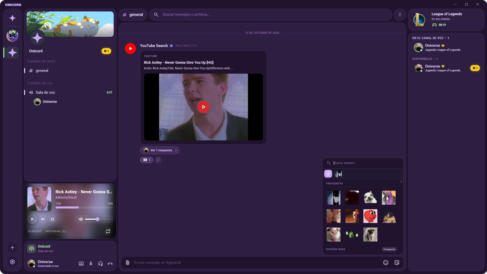

<div align="center">

  

  <p>
    <strong>Serverless communication. Private, direct, and high-fidelity.</strong><br/>
    <em>Decentralized, End-to-End Encrypted, P2P Voice, Video, Chat, and Media Platform.</em>
  </p>

  <p>
    <a href="https://github.com/OniverseDesign/onicord/releases/latest">
      
    </a>
    <a href="https://github.com/OniverseDesign/onicord/releases">
      
    </a>
    <a href="LICENSE">
      
    </a>
    <a href="#native-model-context-protocol-mcp-server-onicord-mcp">
      
    </a>
    <a href="https://ko-fi.com/oniversedesign">
      
    </a>
  </p>

  <p>
    <a href="https://github.com/OniverseDesign/onicord/releases/latest">
      
    </a>
    <a href="https://github.com/OniverseDesign/onicord/releases/latest">
      
    </a>
    <a href="https://github.com/OniverseDesign/onicord/releases/latest">
      
    </a>
  </p>

  <h4>
    <a href="https://github.com/OniverseDesign/onicord/releases/latest">Download</a> ·
    <a href="#core-features">Features</a> ·
    <a href="#architecture-and-technological-innovation">Architecture</a> ·
    <a href="#interactive-dashboard-widgets">Widgets</a> ·
    <a href="#modular-addon-ecosystem-onipkg">Addons</a> ·
    <a href="#native-model-context-protocol-mcp-server-onicord-mcp">MCP Server</a> ·
    <a href="#ecosystem-repositories">Ecosystem</a>
  </h4>

  <br/>

  <a href="https://github.com/OniverseDesign/onicord/releases/latest">
    
  </a>

</div>

---

## Overview

**Onicord** is a sovereign, serverless communication suite built for users who value privacy, audio clarity, and independence. Unlike traditional platforms (such as Discord, Teams, or Slack), Onicord requires **no central accounts, no cloud servers, and no phone numbers**. 

All voice, chat, file sharing, screen streaming, and synchronized music flow directly between room participants over encrypted P2P swarms.

---

## Architecture and Technological Innovation

Onicord replaces centralized client-server relays with an **autonomous, federated P2P mesh network** orchestrated directly by user devices:

```
                  ┌───────────────────────────────┐
                  │      Global DHT (Holepunch)   │
                  └───────────────┬───────────────┘
                                  │ (Signaling / Hole Punching)
         ┌────────────────────────┴────────────────────────┐
         ▼                                                 ▼
┌──────────────────┐    WebRTC Voice Mesh Channel  ┌──────────────────┐
│  Peer A (Client) │◄─────────────────────────────►│  Peer B (Client) │
│                  │                               │                  │
│  - AES-256-GCM   │    P2P Data Channel (TCP)     │  - AES-256-GCM   │
│  - Local Cache   │◄─────────────────────────────►│  - Local Cache   │
└──────────────────┘                               └──────────────────┘
```

* **Decentralized Mesh Network**: Every room participant acts as both client and host. If the original room host goes offline, active peers maintain the room and synchronize history autonomously.
* **DHT Hole Punching with Hyperswarm**: Discovers peers across global Distributed Hash Tables (DHT) and traverses NAT firewalls transparently without manual port forwarding.
* **Cryptographic Bi-Directional State Synchronization**: When peers connect, they reconcile chat logs, channels, roles, and media indexes verified by cryptographic timestamping.
* **Zero-Knowledge Local Storage**: Profiles, private keys, and message history are kept strictly on your local drive in AES-256-GCM encrypted storage. Decryption occurs purely in-memory.

---

## Core Features

### Privacy & Networking
* **Adaptive Connection Engine**: Automatically negotiates the optimal route: **Direct LAN**, **DHT Hole Punching (Hyperswarm)**, direct mapped ports, or custom user-provided **STUN/TURN relays**.
* **End-to-End Encryption (E2EE)**: AES-256-GCM ciphers protect all chat messages, file indices, and room metadata.
* **Privacy-First Game & Activity Scanner**: Detects active games locally against an offline dictionary (`games.json`). No process telemetry, window titles, or private paths leave your computer.
* **1-on-1 Direct Messages & Streaks**: Private encrypted DMs with daily interaction streaks and activity counters.

### Audio, Video & Collaboration
* **Crystal-Clear WebRTC Voice**: Ultra-low latency voice mesh with Opus audio, noise reduction, and smart bandwidth throttling (decoding pauses when peers mute/deafen).
* **60 FPS Screen Sharing & Video**: Smooth multi-stream window/desktop broadcasting with Picture-in-Picture (PiP) support.
* **Synchronized Jukebox & Music Island**: Embedded `yt-dlp` audio streaming from YouTube and SoundCloud, synchronized in real time across the room with dedicated media controls.

### Modern Chat Experience
* **Floating WYSIWYG Formatting Bar**: Contextual styling toolbar on text selection for instant bold, italic, spoilers, quotes, and inline code.
* **Interactive Slash Commands (`/commands`)**: Built-in utilities for server administration, polls, dice rolls (`/roll`), and custom commands.
* **Rich P2P Invite Cards**: Cryptographically signed invite cards with member count previews and 1-click joining.
* **Custom Sticker Packs (`.onipkg`) & Emojis**: Support for animated WebP/APNG stickers and community packs. Discover and contribute collections in the [Official Sticker Packs Repository](https://github.com/OniverseDesign/onicord-stickers).

---

## Interactive Dashboard Widgets

Customize your server view with modular, real-time interactive widgets:

| Widget | Description |
| :--- | :--- |
| **Music Jukebox** | Control room audio, track search, queue management, and volume. |
| **Gaming & Activity** | Real-time game presence, playtime tracking, and status display. |
| **P2P Diagnostics** | Live RTT latency (Ping), WebRTC bitrate (RX/TX), packet loss, and peer counter. |
| **Hardware Monitor** | Desktop CPU, memory usage, and network activity indicators. |
| **Shared Files** | P2P file transfer history, room cache, and local storage access. |
| **Weather Forecast** | Real-time weather, local temperature, and forecasts. |
| **World Clock** | Server uptime clock, stopwatch, and multi-timezone indicators. |

---

## Modular Addon Ecosystem (`.onipkg`)

Extend Onicord with community mini-apps, automated bots, and custom user interfaces. Explore the [Official Addons Repository](https://github.com/OniverseDesign/onicord-addons) to browse open-source plugins, Dashboard Bento widgets, and technical specifications.

* **Standardized Package Format (`.onipkg`)**: Easy drag-and-drop installation via the Addon Manager.
* **Isolated V8 Sandbox**: Plugins execute inside a guarded Node.js V8 sandbox (`pluginSandboxService.cjs`) with fine-grained permission prompts.
* **Developer SDK**: Full access to register custom slash commands, floating panels, theme overlays, and automated responses.
* **Official Registry**: View source code for official addons and Dashboard widgets in [OniverseDesign/onicord-addons](https://github.com/OniverseDesign/onicord-addons).

---

## Native Model Context Protocol (MCP) Server (`onicord-mcp`)

Onicord provides a first-class, built-in **Model Context Protocol (MCP)** server (`mcp-server/`). AI assistants (such as [Antigravity IDE](https://github.com) or [Claude Desktop](https://claude.ai/download)) can monitor, diagnose, and automate Onicord in real-time.

```json
{
  "mcpServers": {
    "onicord-mcp": {
      "command": "node",
      "args": ["path/to/onicord/mcp-server/index.js"]
    }
  }
}
```

<details>
<summary><b>Click to view available MCP Tools & Capabilities</b></summary>
<br/>

* **`onicord_get_live_logs`**: Inspect in-memory `DiagService` logs with level/category filtering in real time.
* **`onicord_request_peer_logs`**: Fetch diagnostic logs directly from remote P2P peers over the encrypted network.
* **`onicord_get_webrtc_stats`**: Real-time inspection of incoming/outgoing bitrates (RX/TX kbps), audio packet loss, audio energy, and transceivers.
* **`onicord_trigger_action`**: Dispatch application actions directly (`toggle_mute`, `toggle_deafen`, `toggle_stream`, `disconnect_voice`, `open_settings`, etc.).
* **`onicord_join_voice_channel` / `onicord_leave_voice_channel`**: Programmatic voice channel automation.

</details>

---

## Technology Stack

* **Desktop Runtime**: [Electron 33](https://www.electronjs.org/) (Isolated Preload & Main processes in CommonJS).
* **User Interface**: [React 18](https://react.dev/) + [Vite 6](https://vite.dev/) + Vanilla CSS (Catppuccin Mocha palette).
* **P2P Networking**: [Hyperswarm](https://github.com/holepunchto/hyperswarm) (DHT & Hole-punching) + [simple-peer](https://github.com/feross/simple-peer) (WebRTC).
* **Media & Audio Engine**: Embedded `yt-dlp` integration with local streaming server.
* **Security & Crypto**: Node.js `crypto` (AES-256-GCM cipher).
* **Internationalization**: `i18next` with full multi-language localization (**Spanish**, **English**, and **Portuguese**), easily extensible by the community.

---

## Downloads & Supported Platforms

Official release assets are available on the [Latest Release Page](https://github.com/OniverseDesign/onicord/releases/latest):

| Platform | Packaging / Format | Architecture | Download Link |
| :--- | :--- | :--- | :--- |
| **Windows** | Setup Installer (`.exe`) | `x64` | [Download Installer](https://github.com/OniverseDesign/onicord/releases/latest) |
| **Windows** | Standalone Portable (`.exe`) | `x64` | [Download Portable](https://github.com/OniverseDesign/onicord/releases/latest) |
| **Linux** | Universal AppImage (`.AppImage`) | `x86_64` | [Download AppImage](https://github.com/OniverseDesign/onicord/releases/latest) |
| **Linux** | Debian / Ubuntu Package (`.deb`) | `amd64` | [Download .deb](https://github.com/OniverseDesign/onicord/releases/latest) |
| **macOS** | Apple Disk Image (`.dmg`) | Apple Silicon (`arm64`) | [Download DMG](https://github.com/OniverseDesign/onicord/releases/latest) |
| **macOS** | Zipped Application Bundle (`.zip`) | Apple Silicon (`arm64`) | [Download Zip](https://github.com/OniverseDesign/onicord/releases/latest) |
| **Verification** | Cryptographic Hashes | All Files | [`SHA256SUMS.txt`](https://github.com/OniverseDesign/onicord/releases/latest/download/SHA256SUMS.txt) |

---

## Ecosystem Repositories

| Repository | Description | Link |
| :--- | :--- | :--- |
| **Onicord Client** | Main desktop application, P2P mesh network engine, and native MCP server. | [OniverseDesign/onicord](https://github.com/OniverseDesign/onicord) |
| **Onicord Addons** | Official catalog, SDK documentation, and open-source `.onipkg` plugins. | [OniverseDesign/onicord-addons](https://github.com/OniverseDesign/onicord-addons) |
| **Onicord Stickers** | Official and community sticker packs repository (`.onipkg`). | [OniverseDesign/onicord-stickers](https://github.com/OniverseDesign/onicord-stickers) |

## Installation and Development

### Prerequisites

* **Node.js**: v20 LTS or higher
* **npm**: v8 or higher

### Getting Started

1. **Clone the repository:**
   ```bash
   git clone https://github.com/OniverseDesign/onicord.git
   cd onicord
   ```

2. **Install dependencies:**
   ```bash
   npm install
   ```

3. **Start the development environment:**
   ```bash
   npm run start
   ```
   *Launches Vite dev server and the Electron native application window concurrently.*

---

## Packaging and Releases

Compile standalone binaries for distribution across platforms:

```bash
# Build Windows binaries (NSIS installer setup & standalone portable exe)
npm run pack
npm run pack:portable

# Build Linux packages (Universal AppImage & Debian .deb package)
npm run pack:linux

# Build macOS bundles (DMG installer & compressed app bundle)
npm run pack:mac

# Synchronize, tag, and publish release directly to GitHub (automated CI build)
npm run export:github
```

Output binaries are generated in `release/` and `project/release/`.

---

## Support and Community

Onicord is free, open-source software under the **GPL-3.0 License**, crafted with passion by **Oniverse**. If you love decentralized software and want to support our independent development:

<div align="center">

[](https://ko-fi.com/oniversedesign)

</div>
